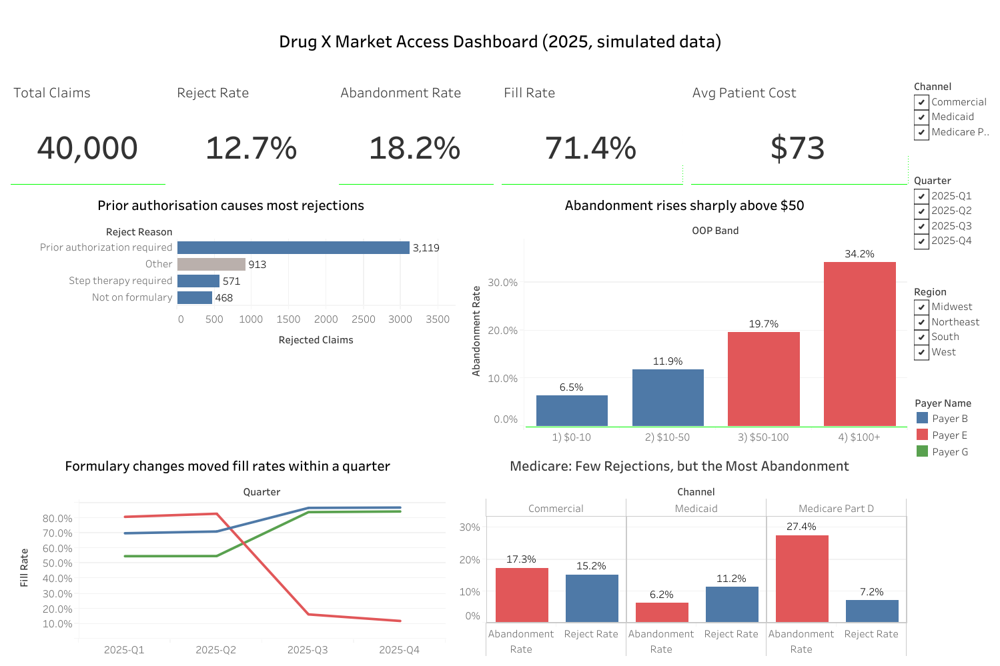

# Drug X Market Access Dashboard

A market access analytics project for a branded drug ("Drug X") in the US. It answers the questions a Value & Access team asks every quarter:

1. How many prescriptions are payers rejecting, and why?
2. How many patients walk away from the pharmacy because the drug costs too much?
3. Do copay cards help?
4. What happened to access when payers changed their formulary?

**Live dashboard:** [Tableau Public](https://public.tableau.com/views/DrugXMarketAccessDashboard2025simulateddata/Dashboard1)



## Data

The data is **simulated** (40,000 pharmacy claims across 12 payers, 12 states and 4 quarters of 2025). Real claims data is private, so the generator builds data that follows how US market access actually works: prior authorization and step therapy cause rejections, high out-of-pocket costs cause abandonment, copay cards only apply to commercial plans, and formulary changes shift access.

| File | What it holds |
|---|---|
| `data/raw_claims.csv` | Raw claims, with duplicates, messy state codes and missing copays left in on purpose |
| `data/payers.csv` | 12 payers with channel (Commercial, Medicare Part D, Medicaid) and covered lives |
| `data/formulary.csv` | Formulary tier, prior authorization and step therapy by payer and quarter |
| `data/regions.csv` | State to US region |
| `data/claims_clean.csv` | **Clean, joined table. Load this into Tableau or Power BI.** |
| `data/access.db` | SQLite database with all four tables |

## Run it

```bash
pip install -r requirements.txt
python generate_data.py      # creates the raw data
python clean_and_analyze.py  # cleans data, runs sql/analysis.sql, writes docs/analysis_results.md
```

Then load `data/claims_clean.csv` into Tableau. The published version is on [Tableau Public](https://public.tableau.com/views/DrugXMarketAccessDashboard2025simulateddata/Dashboard1).

## Key findings

| Finding | Number | So what |
|---|---|---|
| Prior authorization is the biggest barrier | 62% of rejections | Support PA submissions (field reimbursement, e-PA tools) |
| Cost drives abandonment | 6% abandon at $0-10, 34% at $100+ | Keep patient cost under $50 where possible |
| Copay cards work | Abandonment 26% without card vs 7% with card (commercial) | Grow copay card enrolment |
| Medicare patients abandon most | 27% abandonment, avg cost $127 | Copay cards cannot be used in Medicare, so look at foundation support |
| Formulary wins pay off | Payer B and G fill rate rose from ~55-70% to ~85% after moving to preferred tier | Shows the value of payer contracting |
| Formulary loss hurts fast | Payer E fill rate fell from 83% to 12% after dropping Drug X | Flag for the payer account team |

## What the dashboard shows

- **KPI row:** total claims, reject rate, abandonment rate, fill rate and average patient cost
- **Why claims are rejected:** rejected claims by reason
- **Abandonment by out-of-pocket band:** how patient cost drives walk-aways at the pharmacy
- **Fill rate by quarter for payers that changed formulary status:** the effect of formulary wins and losses
- **Reject and abandonment rate by channel:** Commercial, Medicaid and Medicare Part D side by side
- **Filters:** channel, quarter and region

## Data cleaning and quality checks

- Removed 90 duplicate claims
- Standardised 60 badly formatted state codes (`ca ` to `CA`)
- Recovered 39 missing copays from the patient payment; left 11 blank where a copay card hid the original value (not guessed)
- Business rule checks: unique claim IDs, a rejected claim is never filled or abandoned

## Tools

Python (Pandas, NumPy), SQL (SQLite), Tableau Public
